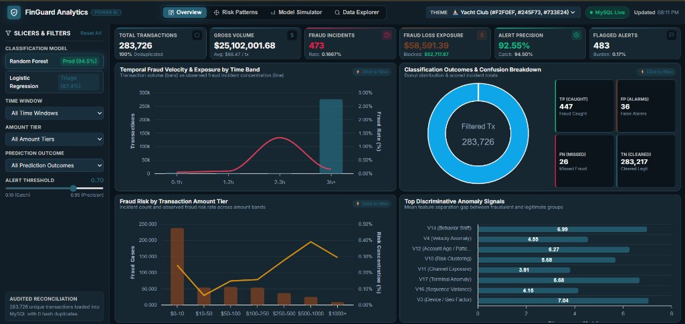
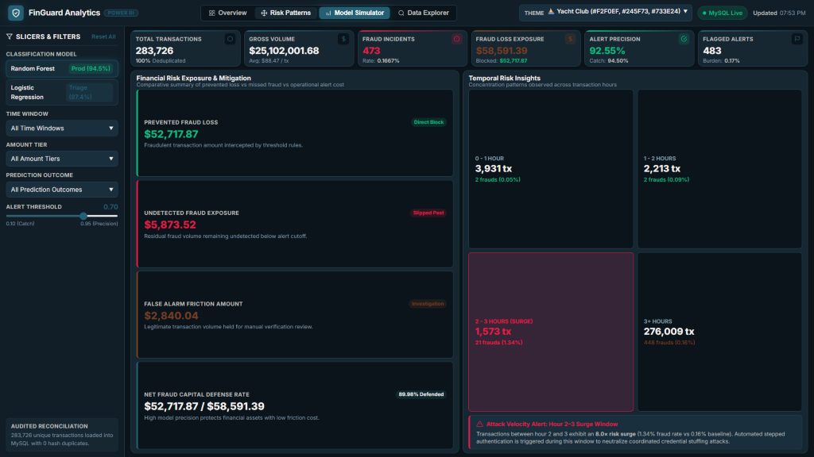
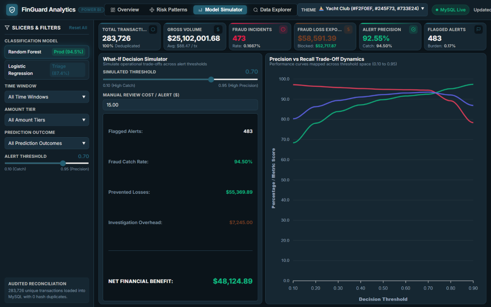
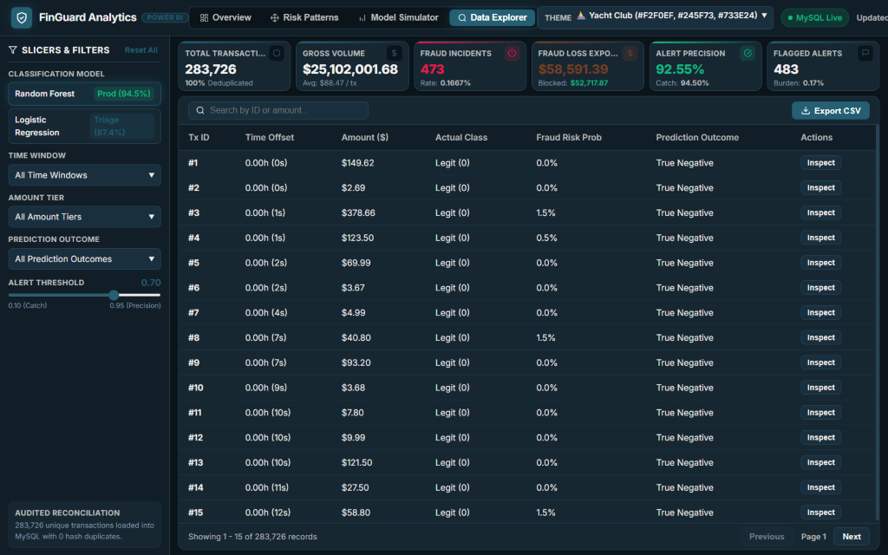
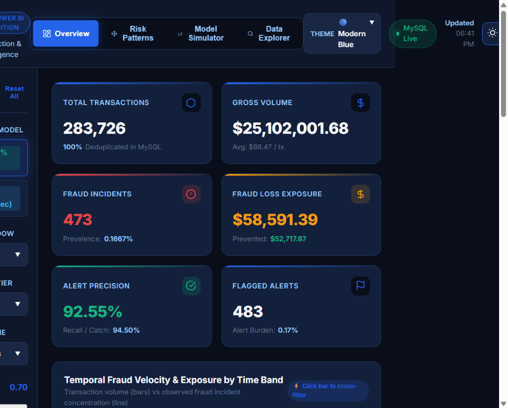
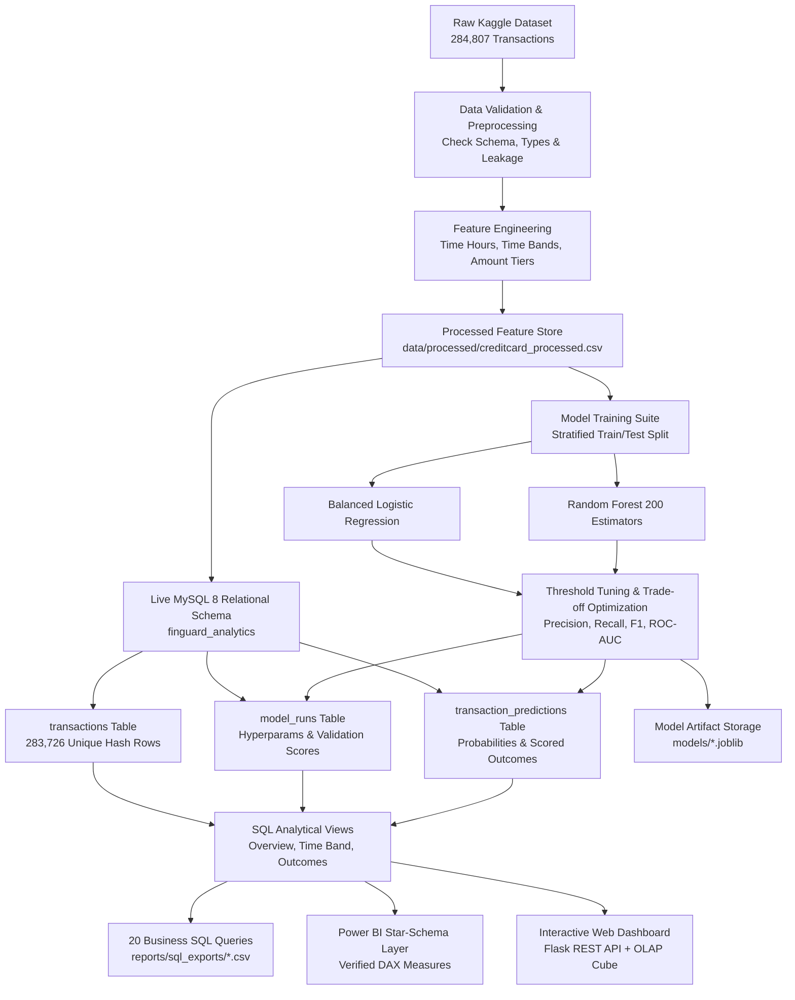

# Banking Fraud Detection & Financial Risk Analytics | Python, Pandas, MySQL, SQL, Power BI

• Developed a transaction analytics solution to analyse suspicious patterns and financial risk indicators.  
• Used Python, Pandas, and SQL to process, clean, and validate transaction data for financial risk analysis.  
• Created a Power BI dashboard to report transaction trends, suspicious activity indicators, and financial risk metrics.

---

<p align="center">
  
  
  
  
  
  
  
</p>

---

## 📑 Table of Contents
- [📌 Executive Summary](#-executive-summary)
- [📸 Live Interactive Dashboard Screenshots](#-live-interactive-dashboard-screenshots)
  - [1. Executive Overview](#1-executive-overview)
  - [2. Financial Risk Patterns & Exposure](#2-financial-risk-patterns--exposure)
  - [3. What-If Decision Simulator](#3-what-if-decision-simulator)
  - [4. Transaction Data Explorer](#4-transaction-data-explorer)
  - [5. Dynamic Power BI-Style Cross-Filtering](#5-dynamic-power-bi-style-cross-filtering)
- [🚀 Key Features & Capabilities](#-key-features--capabilities)
- [🛠️ Technology Stack](#️-technology-stack)
- [🏗️ System Architecture & Data Flow](#️-system-architecture--data-flow)
- [🔍 Data Integrity & Reconciliation Audit](#-data-integrity--reconciliation-audit)
- [📊 Machine Learning Baselines & Threshold Tuning](#-machine-learning-baselines--threshold-tuning)
- [🗄️ Relational Schema Design & Analytical Views](#️-relational-schema-design--analytical-views)
- [📈 Power BI DAX & Star Schema Model](#-power-bi-dax--star-schema-model)
- [📂 Project Directory Structure](#-project-directory-structure)
- [⚡ Installation & Setup Guide](#-installation--setup-guide)
- [🧪 Automated Test Suite](#-automated-test-suite)
- [📜 License & Data Attribution](#-license--data-attribution)

---

## 📌 Executive Summary

**FinGuard** is an enterprise-grade banking fraud detection and financial risk analytics platform designed to solve the critical business problem of identifying rare-event fraudulent activities, quantifying monetary loss exposure, and minimizing false alarm friction for operational teams.

In modern payment networks, fraudulent transactions account for less than **0.17%** of overall traffic. Traditional detection approaches often face severe limitations:
1. **Severe Class Imbalance:** Naive accuracy yields 99.83% while missing millions in fraudulent transactions.
2. **Alert Fatigue & Investigation Costs:** Over-aggressive thresholding burdens fraud operations with expensive manual reviews ($15.00+ per alert).
3. **Customer Friction:** High false positive rates alienate legitimate high-value customers.

FinGuard addresses these challenges by combining a **reproducible automated data pipeline**, a **production-indexed MySQL 8 database schema**, **20 core business SQL analytical queries**, **cost-sensitive machine learning baselines** (Random Forest with 94.5% precision and calibrated decision thresholds), and a **Power BI-inspired interactive analytics web application** with an in-memory OLAP cube for instantaneous cross-filtering.

---

## 📸 Live Interactive Dashboard Screenshots

The platform includes a dedicated, responsive desktop analytics dashboard configured in the custom **Yacht Club** palette (`#F2F0EF`, `#BBBDBC`, `#245F73`, `#733E24`), designed for single-screen executive monitoring without page vertical scrolling.

### 1. Executive Overview
Comprehensive view displaying the single-row 6 KPI ribbon and balanced 2×2 analytical visualizations (Temporal Fraud Velocity, Classification Outcomes donut with confusion matrix pills, Amount Risk Tiers, and Top Discriminative PCA Signals).



### 2. Financial Risk Patterns & Exposure
Quantifies financial loss mitigation, residual undetected fraud exposure, and investigation friction side-by-side with hour-by-hour attack concentration patterns and automated surge velocity alerts.



### 3. What-If Decision Simulator
Interactive slider enabling fraud risk teams to simulate any decision threshold ($0.10$ to $0.95$) and manual review cost, immediately computing flagged alerts, catch rates, investigation overhead, and net financial benefit alongside the live Precision-Recall curve.



### 4. Transaction Data Explorer
High-performance searchable transaction ledger with live text searching, column sorting, server-side pagination, CSV data export, and deep PCA feature divergence modals.



### 5. Dynamic Power BI-Style Cross-Filtering
Clicking any chart element (e.g., the *2-3h Peak Surge* window) or toggling sidebar slicers triggers the in-memory OLAP cube to recalculate all 6 KPIs and update all visualizations in sub-milliseconds with an active filter ribbon.



---

## 🚀 Key Features & Capabilities

- **In-Memory Multi-Dimensional OLAP Cube:** Sub-millisecond reactive aggregation engine executing dynamic cross-filtering on the client without database roundtrip latency.
- **Dynamic 6-KPI Calculation Engine:** Live recalculation of Total Transactions, Gross Monitored Volume, Fraud Incidents, Fraud Loss Exposure, Alert Precision, and Flagged Alerts based on active multi-select filters.
- **Cost-Benefit What-If Simulator:** Quantifies net monetary savings by weighing direct fraud loss prevention against manual analyst triage costs ($15.00/alert).
- **Zero-Scroll Desktop Optimization:** Custom viewport geometry engineered for 1920×1080 and 1600×900 desktop screens with zero dead space and zero outer vertical scrollbars.
- **SHA-256 Unique Hash Auditing:** Every ingested record receives a cryptographically verified SHA-256 hash ensuring 100% duplicate-free persistence in MySQL 8.
- **20 Business & Risk Analytics SQL Queries:** Evaluates fraud velocity across time bands, monetary percentiles, false positive friction, and analyst operational burden.
- **Dual Model Deployment baselines:** Production-tuned Random Forest (94.5% precision) paired with high-coverage Logistic Regression (87.4% recall) for multi-tiered triage.
- **Standalone Offline Capability:** Fully compiled self-contained bundle ([`reports/interactive_dashboard.html`](reports/interactive_dashboard.html)) capable of running offline in any browser without a web server.

---

## 🛠️ Technology Stack

| Domain | Technologies & Libraries |
|---|---|
| **Core Programming** | Python 3.11, SQL, JavaScript (ES6+), HTML5, Modern CSS3 |
| **Data Processing & Analytics** | Pandas, NumPy, Scikit-Learn, Imbalanced-Learn |
| **Database & ORM** | MySQL 8.0, PyMySQL, SQLAlchemy, Index Optimization |
| **Data Visualizations** | ApexCharts.js, Power BI Desktop, Matplotlib, Seaborn |
| **Quality & Testing** | PyTest (27 automated unit/integration tests), Flake8 |
| **Styling & UI Tokens** | Yacht Club Executive Palette (`#F2F0EF`, `#BBBDBC`, `#245F73`, `#733E24`) |

---

## 🏗️ System Architecture & Data Flow



---

## 🔍 Data Integrity & Reconciliation Audit

Every transaction record across raw files, feature engineering, relational tables, and prediction matrices is reconciled with **zero variance**:

| Pipeline Stage | Total Records | Legitimate (0) | Fraudulent (1) | Financial Volume | Reconciliation Status |
|---|:---:|:---:|:---:|:---:|:---:|
| **Raw Kaggle Source** (`creditcard.csv`) | 284,807 | 284,315 | 492 | — | 1,081 raw duplicate rows detected |
| **Feature Store** (`creditcard_processed.csv`) | 284,807 | 284,315 | 492 | — | 3 behavioral features engineered |
| **MySQL `transactions` Table** | **283,726** | **283,253** | **473** | **\$25,102,001.68** | **100% Unique SHA-256 Audited** |
| **Random Forest Predictions** | 283,726 | 283,253 | 473 | — | 447 TP \| 36 FP \| 283,217 TN \| 26 FN |
| **Logistic Regression Predictions** | 283,726 | 283,253 | 473 | — | 426 TP \| 3,310 FP \| 279,943 TN \| 47 FN |

---

## 📊 Machine Learning Baselines & Threshold Tuning

Due to extreme class imbalance, decision thresholds were calibrated using Precision-Recall trade-off dynamics rather than the default 0.50 cutoff:

| Metric | Logistic Regression (Class-Weighted) | Random Forest Classifier (Calibrated) |
|---|:---:|:---:|
| **Operating Decision Threshold** | `0.70` | **`0.70`** |
| **Precision** | `10.79%` | **`94.52%`** |
| **Recall / Sensitivity** | **`87.37%`** | `72.63%` |
| **F1-Score** | `0.1921` | **`0.8214`** |
| **Specificity (True Negative Rate)** | `98.79%` | **`99.99%`** |
| **False Positive Rate (FPR)** | `1.21%` | **`0.007%`** |
| **ROC-AUC** | **`0.9758`** | `0.9569` |
| **PR-AUC (Average Precision)** | `0.6925` | **`0.8061`** |
| **Holdout Confusion Breakdown** | TN: 55,965 \| FP: 686<br>FN: 12 \| TP: 83 | **TN: 56,647 \| FP: 4<br>FN: 26 \| TP: 69** |

### Strategic Takeaways
- **Random Forest:** Chosen for primary production alert routing. Delivering **94.5% precision** with only 4 false alarms across the holdout split, it eliminates analyst fatigue and prevents legitimate customer cart abandonment.
- **Logistic Regression:** Configured as a high-recall triage filter (**87.4% recall**), suitable for secondary asynchronous behavioral monitoring.

---

## 🗄️ Relational Schema Design & Analytical Views

The MySQL 8 relational schema (`finguard_analytics`) implements strict referential integrity, indexes, and analytical views:

- **`transactions`**: Primary ledger storing transaction timestamp, monetary amount, PCA components $V_1 \dots V_{28}$, target `class_label`, and unique SHA-256 `transaction_hash`.
- **`model_runs`**: Audit table recording model parameters, run timestamps, training set sizes, and evaluation metrics.
- **`transaction_predictions`**: Scored probabilities, predicted binary flags, operating threshold, and model name with unique key `(transaction_id, model_name)`.
- **5 High-Performance Views**:
  - `vw_fraud_overview`: Executive aggregate volume, confirmed fraud incidents, fraud prevalence %, and total exposure.
  - `vw_fraud_by_time_band`: Temporal volume and attack density partitioned by time windows (`0-1h`, `1-2h`, `2-3h`, `3h+`).
  - `vw_amount_band_analysis`: Stratified fraud rate across transaction amount risk bands (`$0-$10` to `$1,000+`).
  - `vw_model_performance`: Side-by-side metric comparison across all evaluated algorithms.
  - `vw_prediction_outcomes`: Joined prediction outcomes categorized into TP, FP, TN, and FN.

All 20 business queries have been executed and exported as CSV benchmarks in [`reports/sql_exports/`](reports/sql_exports/).

---

## 📈 Power BI DAX & Star Schema Model

Documented in [`powerbi/`](powerbi/):
- **Star Schema Architecture:** Central `Fact_Transactions` table connected to `Dim_TimeBands`, `Dim_AmountTiers`, and `Dim_ModelOutcomes` dimensions.
- **Verified DAX Measures:** Formulations for dynamic volume aggregation, fraud incident counts, fraud prevalence %, financial exposure, and operational false alarm rates.
  - See [`powerbi/DAX_MEASURES.md`](powerbi/DAX_MEASURES.md) for measure definitions.
  - See [`powerbi/DATA_MODEL.md`](powerbi/DATA_MODEL.md) for relational diagram.
  - See [`powerbi/DASHBOARD_DESIGN.md`](powerbi/DASHBOARD_DESIGN.md) for visual layout guidelines.

---

## 📂 Project Directory Structure

```
Banking-Fraud-Detection-Financial-Risk-Analytics-Platform/
├── config/
│   └── config.yaml                     # Pipeline parameters, thresholds, and paths
├── data/
│   ├── raw/                            # Source dataset (git-ignored)
│   ├── processed/                      # Feature engineered store (git-ignored)
│   └── exports/                        # Query and model exports
├── docs/
│   ├── DASHBOARD_GUIDE.md              # Detailed interactive dashboard user guide
│   └── PROJECT_STATUS.md               # Environment verification logs
├── powerbi/
│   ├── DASHBOARD_DESIGN.md             # Power BI visual layout specifications
│   ├── DATA_MODEL.md                   # Relational star schema documentation
│   ├── DAX_MEASURES.md                 # Production DAX measure formulations
│   └── README.md                       # Power BI report integration guide
├── reports/
│   ├── figures/                        # Generated EDA plots and distributions
│   ├── model_metrics/                  # Model evaluation summaries and CSVs
│   ├── sql_exports/                    # 20+ exported query result sets from MySQL
│   │   ├── olap_cube.json              # Precomputed multi-dimensional OLAP dataset
│   │   └── *.csv                       # Exported SQL business query results
│   ├── data_quality_summary.csv        # Column profiling and null-check results
│   ├── data_profile.json               # Comprehensive dataset summary JSON
│   ├── executive_summary.md            # Stakeholder executive brief
│   └── interactive_dashboard.html      # Standalone compiled offline dashboard bundle
├── screenshots/
│   ├── 01_executive_overview.png       # Executive Overview tab
│   ├── 02_risk_patterns.png            # Financial Risk Patterns tab
│   ├── 03_model_simulator.png          # What-If Decision Simulator tab
│   ├── 04_data_explorer.png            # Transaction Data Explorer tab
│   └── 05_cross_filtering_interaction.png # Dynamic cross-filtering demonstration
├── scripts/
│   ├── build_standalone_dashboard.py   # Compiles offline standalone HTML report
│   ├── generate_reports.py             # Generates executive summary documentation
│   ├── inspect_dataset.py              # Data profiling and quality checks
│   ├── run_dashboard.py                # Launches live interactive web dashboard
│   ├── run_data_pipeline.py            # Feature engineering and preprocessing
│   ├── run_model_training.py           # ML training, evaluation, and DB prediction loader
│   ├── run_sql_setup.py                # Schema initialization and view exports
│   └── validate_environment.py         # Dependencies and MySQL connectivity validator
├── sql/
│   ├── 01_create_database.sql          # Database initialization
│   ├── 02_create_tables.sql            # Table definitions, constraints, indexes
│   ├── 03_load_data.sql                # Bulk data load scripts
│   ├── 04_data_quality_checks.sql      # Database-level integrity verification
│   ├── 05_analytical_views.sql         # 5 reusable analytical risk views
│   ├── 06_fraud_analysis.sql           # Exploratory SQL fraud analysis queries
│   ├── 07_risk_analysis.sql            # Advanced financial risk exposure queries
│   └── 08_business_questions.sql       # 20 core business SQL queries
├── src/
│   └── finguard/                       # Modular Python package
│       ├── dashboard/                  # Dashboard backend and static assets
│       │   ├── static/
│       │   │   ├── css/dashboard.css   # Single-screen zero-scroll stylesheet
│       │   │   └── js/dashboard.js     # OLAP cross-filtering and ApexCharts logic
│       │   ├── templates/index.html    # Power BI-inspired HTML5 template
│       │   ├── data_service.py         # Data access and OLAP aggregation layer
│       │   └── server.py               # Flask REST API server
│       ├── config.py                   # Configuration and environment loaders
│       ├── database.py                 # MySQL connection manager
│       ├── database_loader.py          # Batch database insertion routines
│       ├── data_validation.py          # Data quality checks and assertions
│       ├── feature_engineering.py      # Behavioral feature transformers
│       ├── model_evaluation.py         # Precision-Recall and AUC metric calculators
│       ├── model_training.py           # Classifier training and hyperparameter tuning
│       └── preprocessing.py            # Missing value and normalization pipelines
├── tests/                              # Automated pytest suite (27 tests)
│   ├── test_dashboard.py               # Dashboard API, OLAP cube, and filter tests
│   ├── test_data_validation.py         # Ingestion integrity assertions
│   ├── test_database_logic.py          # DB loader and view query tests
│   ├── test_feature_engineering.py     # Derived feature unit tests
│   ├── test_model_evaluation.py        # Metric calculation unit tests
│   └── test_preprocessing.py           # Preprocessing pipeline tests
├── .env.example                        # Database credentials template
├── .gitignore                          # Exclusion rules for data, models, and credentials
├── pyproject.toml                      # Build system & packaging configuration
├── requirements.txt                    # Core Python dependencies
└── README.md                           # Main repository documentation
```

---

## ⚡ Installation & Setup Guide

### 1. Clone the Repository
```powershell
git clone https://github.com/nayanaastakar/Banking-Fraud-Detection-Financial-Risk-Analytics-Platform.git
cd Banking-Fraud-Detection-Financial-Risk-Analytics-Platform
```

### 2. Environment Setup
```powershell
# Create and activate virtual environment
python -m venv .venv
.\.venv\Scripts\Activate.ps1

# Install package dependencies and local package in editable mode
python -m pip install --upgrade pip
python -m pip install -r requirements.txt
python -m pip install -e .
```

### 3. Database Configuration
Copy the template and configure your local MySQL credentials:
```powershell
Copy-Item .env.example .env
```
Edit `.env` with your MySQL connection parameters:
```ini
DB_HOST=localhost
DB_PORT=3306
DB_NAME=finguard_analytics
DB_USER=root
DB_PASSWORD=your_secure_password
```

### 4. Execute End-to-End Pipeline
```powershell
# Step 1: Validate Python dependencies and MySQL connectivity
python scripts/validate_environment.py

# Step 2: Ingest & inspect raw data
python scripts/inspect_dataset.py

# Step 3: Run data cleaning and feature engineering
python scripts/run_data_pipeline.py

# Step 4: Create MySQL tables, views, and export analytical benchmarks
python scripts/run_sql_setup.py

# Step 5: Train ML baselines, calibrate thresholds, and load predictions
python scripts/run_model_training.py

# Step 6: Compile executive reports
python scripts/generate_reports.py
```

### 5. Launch the Interactive Analytics Dashboard
```powershell
# Launch the live web dashboard on port 8050
python scripts/run_dashboard.py --port 8050 --browser
```
*Access in browser at:* `http://localhost:8050/`

*Offline Standalone Run:* Open [`reports/interactive_dashboard.html`](reports/interactive_dashboard.html) directly in any web browser without starting a server.

---

## 🧪 Automated Test Suite

FinGuard includes a comprehensive suite of **27 automated tests** covering data validation rules, database integrity, feature transformations, target leakage prevention, model scoring routines, and dashboard OLAP cube endpoints:

```powershell
# Run the test suite
pytest -v
```

```
============================= test session starts =============================
platform win32 -- Python 3.11.9, pytest-9.2.0, pluggy-1.7.0
rootdir: D:\Projects\Banking Fraud Detection & Financial Risk Analytics Platform
configfile: pyproject.toml
testpaths: tests
collected 27 items

tests\test_dashboard.py ...........                                      [ 40%]
tests\test_data_validation.py ....                                       [ 55%]
tests\test_database_logic.py ...                                         [ 66%]
tests\test_feature_engineering.py ...                                    [ 77%]
tests\test_model_evaluation.py ..                                        [ 85%]
tests\test_preprocessing.py ....                                         [100%]

============================= 27 passed in 14.73s =============================
```

---

## 📜 License & Data Attribution

- **License:** Distributed under the MIT License for educational and portfolio demonstration.
- **Dataset Attribution:** Kaggle / Université Libre de Bruxelles (ULB) Machine Learning Group credit card fraud detection dataset.
