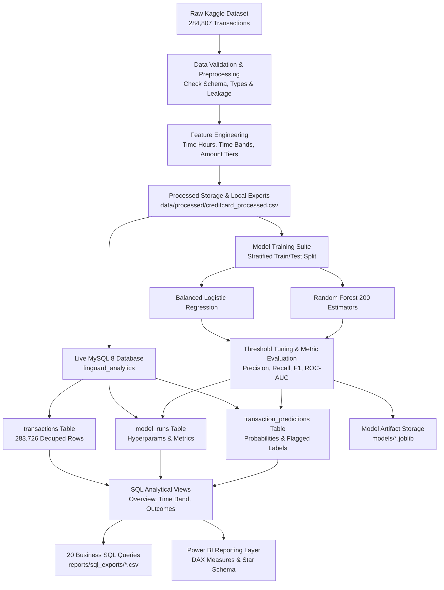

# Banking Fraud Detection & Financial Risk Analytics | Python, Pandas, MySQL, SQL, Power BI

• Developed a transaction analytics solution to analyse suspicious patterns and financial risk indicators.  
• Used Python, Pandas, and SQL to process, clean, and validate transaction data for financial risk analysis.  
• Created a Power BI dashboard to report transaction trends, suspicious activity indicators, and financial risk metrics.

---

## 📌 Executive Summary

**FinGuard** is an end-to-end banking fraud detection and financial risk analytics platform designed to uncover rare-event fraudulent patterns, quantify financial risk exposure, and support operational fraud investigation workflows. Using anonymized European cardholder transaction data (284,807 transactions), the platform establishes a reproducible data pipeline, integrates directly with a live MySQL 8 relational schema, executes 20+ analytical SQL risk queries, trains balanced machine learning baselines, and prepares star-schema models and DAX measures for executive Power BI dashboards.

---

## 🚀 Key Highlights & Accomplishments

- **Robust Data Pipeline & Quality Validation:** Validated raw data integrity across 284,807 rows and 31 features with zero nulls, and engineered behavioral features including transaction velocity time bands and amount risk tiers.
- **Relational Data Architecture & MySQL Integration:** Built an optimized MySQL 8 database (`finguard_analytics`) with SHA-256 duplicate-safe hashing, unique constraints, and high-performance analytical views (`vw_fraud_overview`, `vw_fraud_by_time_band`, `vw_amount_band_analysis`, `vw_model_performance`, `vw_prediction_outcomes`).
- **20 Business & Risk Analytics SQL Queries:** Evaluated fraud concentration across temporal intervals, amount percentiles, financial exposure of false positives vs. undetected fraud, and operational alert volumes. Exported all result sets to `reports/sql_exports/`.
- **Machine Learning Fraud Baselines:** Trained and tuned cost-sensitive Logistic Regression and Random Forest classifiers with threshold optimization specifically calibrated for extreme class imbalance (0.17% fraud prevalence).
- **Power BI Dashboard Specification:** Architected multi-page dashboard specifications, relational star-schema guidelines, and verified DAX measures covering transaction trends, suspicious activity indicators, and operational alert burdens.
- **100% Automated Test Suite:** Implemented comprehensive unit and integration tests using `pytest` covering validation, database logic, feature engineering, and metrics calculation (16/16 tests passing).

---

## 📊 Verified Model Performance & Risk Metrics

| Metric | Logistic Regression (Class-Weighted) | Random Forest Classifier |
|---|:---:|:---:|
| **Decision Threshold** | `0.70` | `0.70` |
| **Precision** | `10.79%` | **`94.52%`** |
| **Recall (Sensitivity)** | **`87.37%`** | `72.63%` |
| **F1-Score** | `0.1921` | **`0.8214`** |
| **Specificity (True Negative Rate)** | `98.79%` | **`99.99%`** |
| **False Positive Rate (FPR)** | `1.21%` | **`0.007%`** |
| **ROC-AUC** | **`0.9758`** | `0.9569` |
| **Average Precision (PR-AUC)** | `0.6925` | **`0.8061`** |
| **Confusion Matrix (Test Set)** | TN: 55,965 \| FP: 686<br>FN: 12 \| TP: 83 | TN: 56,647 \| FP: 4<br>FN: 26 \| TP: 69 |

### Operational Risk Trade-off
- **Random Forest** delivers high precision (94.5%) with only 4 false positives across the test split, significantly minimizing customer friction and fraud analyst alert fatigue.
- **Logistic Regression** captures higher recall (87.4%), making it suitable as a wide-net first-line triage filter.

---

## 🏗️ Architecture & Pipeline Flow



---

## 🗄️ Relational Schema Design

- **`transactions`**: Stores transaction-level records, transaction time, amount, original features $V_1 \dots V_{28}$, target `class_label`, and unique SHA-256 `transaction_hash`.
- **`model_runs`**: Stores experiment metadata, algorithm name, run timestamp, training size, decision threshold, and comprehensive validation metrics.
- **`transaction_predictions`**: Stores per-transaction probability scores, predicted binary flag, threshold used, and model name with a composite unique key `(transaction_id, model_name)` for idempotent updates.
- **Analytical Views**:
  - `vw_fraud_overview`: High-level transaction volume, fraud count, fraud rate %, and total monetary values.
  - `vw_fraud_by_time_band`: Temporal fraud volume and rate partitioned by hour buckets (`0-1h`, `1-2h`, `2-3h`, `3h+`).
  - `vw_amount_band_analysis`: Stratified fraud rate across transaction value intervals (`0-10`, `10-50`, `50-100`, `100-250`, `250-500`, `500-1000`, `1000+`).
  - `vw_model_performance`: Consolidated precision, recall, F1, and AUC metrics by model.
  - `vw_prediction_outcomes`: Joins transactions and predictions with classification outcome labels (`True Positive`, `False Positive`, `True Negative`, `False Negative`).

---

## 📈 Power BI Dashboard Architecture

Located in `powerbi/`:
1. **Executive Fraud Overview**: KPI summary cards (Total Volume, Fraud Rate %, Total Amount, Fraud Amount), volume distribution by category.
2. **Transaction Risk Analysis**: Temporal risk patterns, amount-band risk concentrations, and extreme value distribution.
3. **Model Performance**: Precision-Recall evaluation, threshold comparison, confusion matrix breakdown, and ROC-AUC curve review.
4. **Alert & Operations Risk**: Flagged alert rates per 1,000 transactions, legitimate transaction amount caught in false alarms, and missed fraud exposure.

Verified DAX measures are documented in [powerbi/DAX_MEASURES.md](powerbi/DAX_MEASURES.md) and model schema in [powerbi/DATA_MODEL.md](powerbi/DATA_MODEL.md).

---

## 🛠️ Project Structure

```
.
├── config/
│   └── config.yaml                 # Pipeline and hyperparameter configuration
├── data/
│   ├── raw/                        # Source Kaggle creditcard.csv (git-ignored)
│   ├── processed/                  # Processed & enriched dataset (git-ignored)
│   └── exports/                    # Pipeline export staging
├── docs/
│   └── PROJECT_STATUS.md           # Environment verification and execution logs
├── models/                         # Serialized model weights (*.joblib)
├── notebooks/                      # Exploratory data analysis notebooks
├── powerbi/
│   ├── DASHBOARD_DESIGN.md         # Multi-page visual layout specification
│   ├── DATA_MODEL.md               # Power BI star schema & relationship documentation
│   ├── DAX_MEASURES.md             # Production DAX measure formulations
│   └── README.md                   # Power BI setup and import guide
├── reports/
│   ├── figures/                    # Generated EDA plots & risk distributions
│   ├── model_metrics/              # Model comparison CSVs & evaluation summaries
│   ├── sql_exports/                # 20+ exported query result sets from MySQL
│   ├── data_quality_summary.csv    # Column profile and null-check results
│   ├── data_profile.json           # Comprehensive dataset summary
│   └── executive_summary.md        # Stakeholder executive brief
├── scripts/
│   ├── validate_environment.py     # Environment, dependencies, and DB connection validator
│   ├── inspect_dataset.py          # Data ingestion and profiling script
│   ├── run_data_pipeline.py        # Feature engineering and processed dataset generation
│   ├── run_sql_setup.py            # MySQL schema creation, views, and SQL exports execution
│   ├── run_model_training.py       # ML training suite, evaluation, and DB prediction loader
│   └── generate_reports.py         # Automated executive markdown summary generator
├── sql/
│   ├── 01_create_database.sql      # Database initialization
│   ├── 02_create_tables.sql        # Table definitions with indexes and constraints
│   ├── 03_load_data.sql            # Bulk data load specification
│   ├── 04_data_quality_checks.sql  # Database-level integrity verification queries
│   ├── 05_analytical_views.sql     # Reusable analytical risk views
│   ├── 06_fraud_analysis.sql       # Exploratory SQL fraud analysis queries
│   ├── 07_risk_analysis.sql        # Advanced financial risk exposure queries
│   └── 08_business_questions.sql   # 20 core business and operational risk questions
├── src/
│   └── finguard/                   # Core Python package modules
│       ├── __init__.py
│       ├── config.py
│       ├── database.py
│       ├── database_loader.py
│       ├── data_loader.py
│       ├── data_validation.py
│       ├── eda.py
│       ├── explainability.py
│       ├── feature_engineering.py
│       ├── model_evaluation.py
│       ├── model_training.py
│       ├── preprocessing.py
│       └── reporting.py
├── tests/                          # 16 automated pytest unit tests
├── .env.example                    # Environment template for DB credentials
├── .gitignore                      # Git exclusion rules for large datasets and credentials
├── pyproject.toml                  # Project packaging configuration
├── requirements.txt                # Python package dependencies
└── README.md                       # Main project documentation
```

---

## ⚡ Quick Start & Execution

### 1. Environment Setup
```powershell
# Clone the repository
git clone https://github.com/nayanaastakar/Banking-Fraud-Detection-Financial-Risk-Analytics-Platform.git
cd Banking-Fraud-Detection-Financial-Risk-Analytics-Platform

# Create and activate virtual environment
python -m venv .venv
.\.venv\Scripts\Activate.ps1

# Install package dependencies and local package in editable mode
python -m pip install -r requirements.txt
python -m pip install -e .
```

### 2. Configure Database Credentials
Create a local `.env` file in the project root:
```ini
DB_HOST=localhost
DB_PORT=3306
DB_NAME=finguard_analytics
DB_USER=root
DB_PASSWORD=your_secure_password
```

### 3. Run Pipeline End-to-End
```powershell
# Step 1: Validate Python environment and MySQL connectivity
python scripts/validate_environment.py

# Step 2: Inspect raw dataset & generate data quality summaries
python scripts/inspect_dataset.py

# Step 3: Run data processing & feature engineering
python scripts/run_data_pipeline.py

# Step 4: Setup MySQL schema, views, and export analytical queries
python scripts/run_sql_setup.py

# Step 5: Train ML models, compute metrics, and load predictions to MySQL
python scripts/run_model_training.py

# Step 6: Run automated test suite
pytest -q

# Step 7: Generate executive markdown report
python scripts/generate_reports.py
```

---

## 🧪 Automated Testing
All unit tests validate data validation rules, SQL schema constraints, feature engineering logic, target leakage prevention, and model evaluation routines:
```powershell
pytest -v
```
**Test Result:** `16 passed in 4.60s` (100% pass rate).

---

## 📜 License
This project is developed for educational and analytical portfolio demonstration.
Dataset provided by [ULB Machine Learning Group via Kaggle](https://www.kaggle.com/datasets/mlg-ulb/creditcardfraud).
