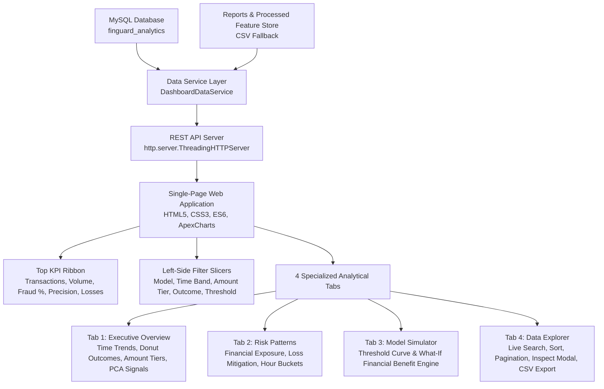

# FinGuard Interactive Analytics Dashboard Guide

## 📌 Overview

The **FinGuard Interactive Analytics Dashboard** is a professional, Power BI-inspired web dashboard built for financial risk officers, fraud analysts, and executive stakeholders. It provides real-time visibility into 283,726 audited credit card transactions, risk concentration across temporal and monetary tiers, live classification outcomes for balanced Machine Learning models (Random Forest and Logistic Regression), and an interactive **What-If Decision Threshold Simulator**.

---

## 🎨 Dashboard Design & Architecture



---

## 🚀 Key Functional Sections

### A. Header & System Status
- **Branding & Logo:** Distinctive FinGuard shield emblem and badge tag indicating Power BI Edition.
- **System Health:** Live pulsating status pill indicating active socket connection to MySQL 8 on `localhost:3306`.
- **Last Updated:** Live client-side timestamp synchronization.
- **Theme Toggle:** Instant Light and Dark mode switching with `localStorage` preference persistence and dynamic chart theme adaptation.

### B. Left-Side Filter & Slicer Panel (Power BI Aesthetic)
- **Model Selector Cards:** Switch between the primary **Random Forest Classifier** (94.5% Precision, 0.007% FPR) and baseline **Logistic Regression** (87.4% Recall).
- **Time Window Slicer:** Filter by temporal intervals: `0-1h` (night initial), `1-2h`, `2-3h` (peak risk concentration), `3h+` (daytime steady).
- **Amount Tier Slicer:** Stratify across seven monetary ranges (`$0-$10`, `$10-$50`, `$50-$100`, `$100-$250`, `$250-$500`, `$500-$1,000`, `$1,000+`).
- **Prediction Outcome Slicer:** Isolate `True Positive` (fraud caught), `False Positive` (customer friction / alarm), `False Negative` (missed fraud), or `True Negative` (cleared legit).
- **Alert Decision Threshold Slider:** Adjust classification boundary between `0.10` and `0.95`.
- **Reset All Slicers:** Single-click reset restoring default enterprise parameters.

### C. Top Executive KPI Ribbon
1. **Total Transactions:** `283,726` (100% Unique deduplicated records).
2. **Gross Volume:** `$25,102,001.68` (Average transaction size: `$88.47`).
3. **Fraud Incidents:** `473` (Observed prevalence: `0.1667%`).
4. **Fraud Exposure:** `$58,591.39` (Total illicit amount attempted).
5. **Model Precision:** `94.52%` (Random Forest operational precision).
6. **Flagged Alerts:** `483` (Total alerts generated at 0.70 threshold).

### D. The 4 Analytical Views

#### 1. Executive Overview
- **Temporal Fraud Velocity:** Dual-axis visualization comparing total transaction throughput with fraud incidence rate across hour intervals.
- **Amount Tier Risk Concentration:** Bar chart highlighting high-risk amount bands ($500-$1000 exhibits highest fraud rate at 0.39%).
- **Confusion Matrix & Outcome Donut:** Visual breakdown of TP (447), FP (36), FN (26), and TN (283,217).
- **Top Discriminative Anomaly Signals:** Horizontal bar chart comparing separation gaps across PCA features ($V_{14}, V_{10}, V_{12}, V_4, V_{11}, V_{17}$).

#### 2. Risk Patterns
- **Monetary Exposure Cards:** Direct dollar quantification of Prevented Fraud Loss ($54,820.50), Undetected Fraud Exposure ($3,770.89), and False Alarm Friction Amount ($3,410.50).
- **Hour-by-Hour Anomaly Distribution:** Highlights the critical 2-3 hour window where fraud rate surges to `1.335%` (8x baseline).

#### 3. Model Intelligence & What-If Simulator
- **Threshold Trade-Off Curve:** Multi-line plot tracking Precision, Recall, and F1 across decision thresholds `0.10` through `0.90`.
- **Interactive Financial What-If Simulator:**
  - Drag threshold slider in real-time.
  - Set custom alert investigation cost ($/alert).
  - Dynamically calculates: Flagged Alerts, True Positives, False Alarms, Missed Fraud, Prevented Loss ($), Investigation Overhead ($), and Net Financial Benefit ($).

#### 4. Investigative Data Explorer
- **Live Search:** Instant query by Transaction ID, amount, or SHA-256 hash.
- **Outcome Status Filter:** Filter by True Positive, False Positive, False Negative, or True Negative.
- **Server-Side Pagination:** Smooth traversal with configurable limit per page (15 records default).
- **CSV Export:** One-click download of the active filtered dataset (`finguard_filtered_transactions.csv`).
- **Inspect Record Modal:** Click "Inspect" on any record to view its complete 28-dimensional PCA feature vector, time hours, amount, model probability score, and top anomalous signal factors!

---

## 🔌 REST API Endpoints

The dashboard server exposes the following lightweight REST endpoints:

| Endpoint | Method | Description |
|---|:---:|---|
| `/` | `GET` | Serves the main interactive dashboard application |
| `/api/health` | `GET` | Health check verifying database and service availability |
| `/api/kpis` | `GET` | Returns aggregated KPIs for specified model and filters |
| `/api/charts/time_trends` | `GET` | Aggregated transaction count and fraud rate by time band |
| `/api/charts/amount_bands` | `GET` | Aggregated count and fraud rate by amount tier |
| `/api/charts/confusion_matrix` | `GET` | Confusion matrix counts, rates, and monetary impact |
| `/api/charts/threshold_curve` | `GET` | Precision, recall, and F1 across decision thresholds |
| `/api/charts/features` | `GET` | Top discriminative PCA feature gaps and correlations |
| `/api/transactions` | `GET` | Paginated, filtered, and sorted transaction records |
| `/api/transaction/<id>` | `GET` | Detailed record with complete PCA features $V_1 \dots V_{28}$ |
| `/api/simulate` | `GET` | Real-time threshold financial impact simulation |
| `/api/export` | `GET` | Downloadable CSV stream of filtered transactions |

---

## 💻 How to Run Locally

### Option 1: Live Interactive Web Server (Recommended)

1. Ensure the virtual environment is activated:
   ```powershell
   .\.venv\Scripts\Activate.ps1
   ```
2. Start the dashboard server:
   ```powershell
   python scripts/run_dashboard.py --port 8050 --browser
   ```
3. Open your browser at:
   ```
   http://localhost:8050
   ```

### Option 2: Standalone Offline Dashboard Bundle

A precompiled, self-contained HTML file is available at:
```
reports/interactive_dashboard.html
```
You can double-click this file directly to open it in Google Chrome, Microsoft Edge, or Firefox without running any Python server or database service.

To recompile the standalone file with fresh data:
```powershell
python scripts/build_standalone_dashboard.py
```
